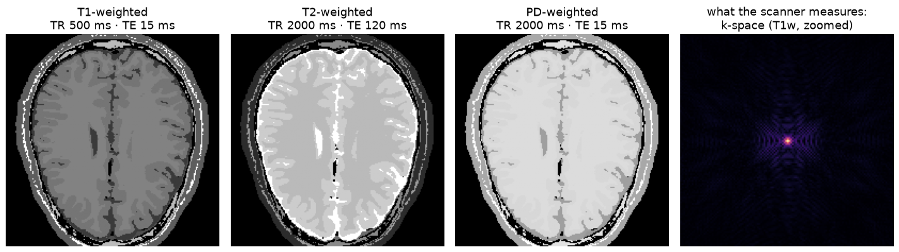
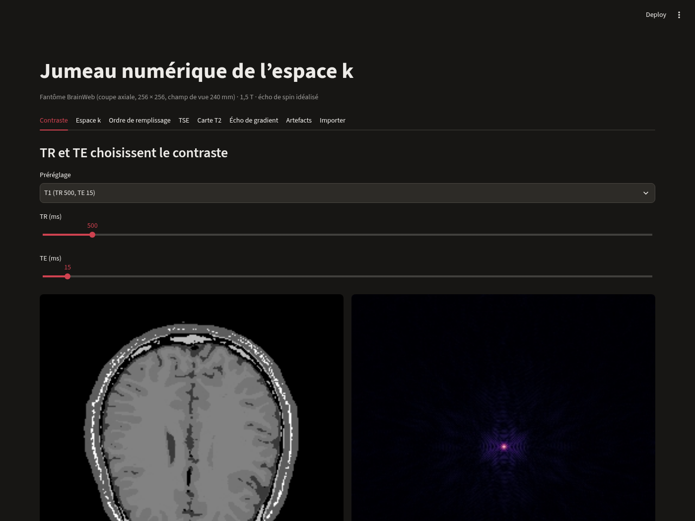
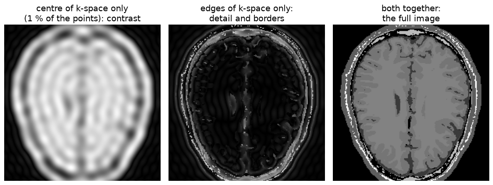
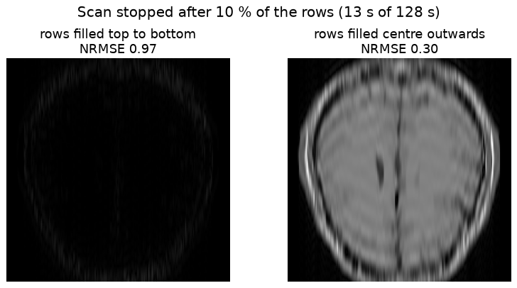
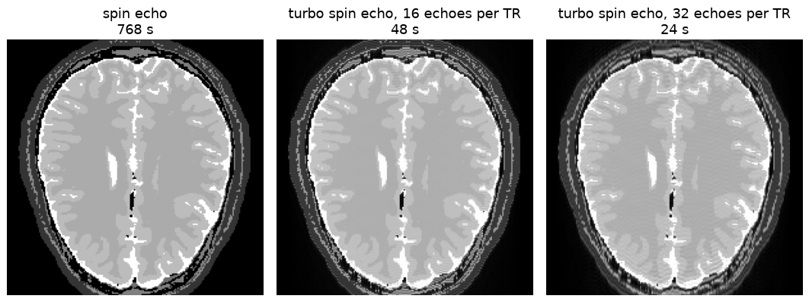
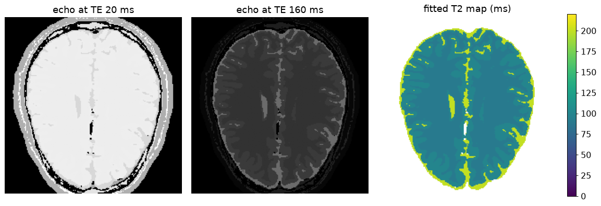
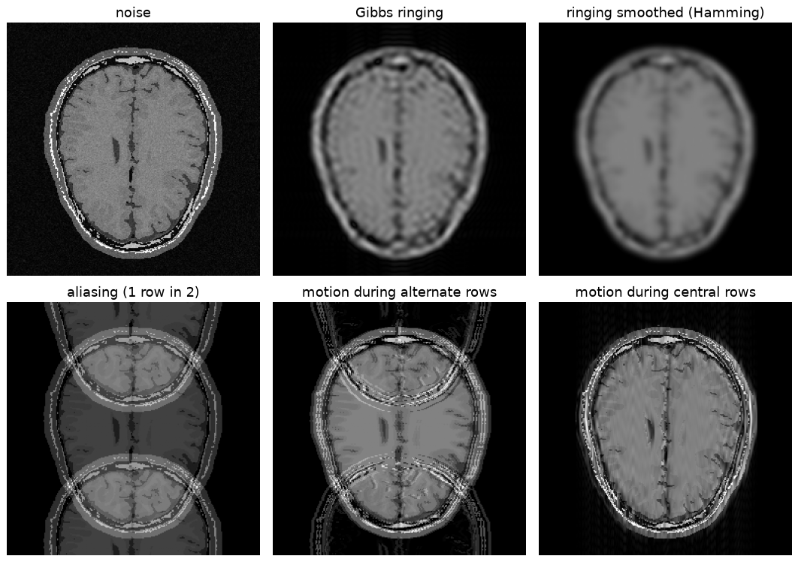
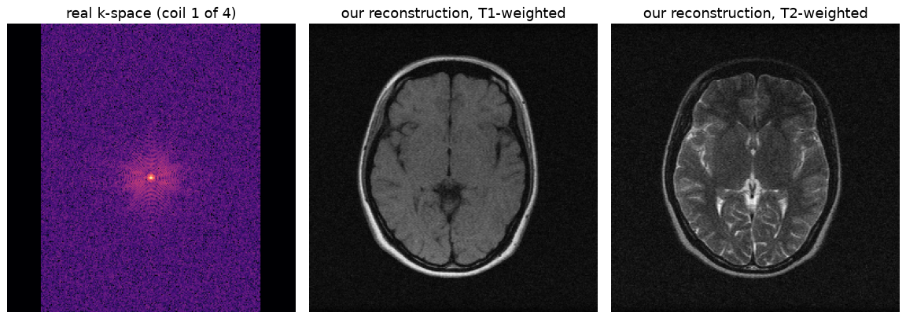

# k-space digital twin

**An MRI scanner you can run on your laptop.** It shows what an MRI machine really measures, a grid of numbers called *k-space*, and how every setting you pick turns into the image a radiologist sees.



An MRI scanner never takes a photo. It measures **k-space**: how much of each stripe pattern the body contains. The image is computed from it afterwards. This project rebuilds that process in Python, step by step, so you can watch it happen:

- change **TR and TE** and see T1-, T2- or PD-weighted contrast appear
- keep only the **centre** or the **edges** of k-space and see what each one carries
- stop a scan halfway and see why the **order** the rows are filled in matters
- speed a scan up 16× with a **turbo spin echo** and see what it costs
- fit a real **T2 map**, in milliseconds, pixel by pixel
- create **artefacts** (noise, ringing, aliasing, motion ghosts) the way a scanner does
- load **real raw k-space** from a scanner and reconstruct it

## Try it

```bash
git clone <this repo>
cd kspace-digital-twin
python -m venv .venv && source .venv/bin/activate
pip install -r requirements.txt
streamlit run app.py
```

The demo opens in your browser. Its interface is in French, because it started as a class presentation given in French.



## A short tour

### The centre of k-space is the contrast, the edges are the detail

Each point of k-space is one stripe pattern spread over the whole image. Points near the centre are wide, slow stripes: overall brightness and the contrast between tissues. Points far out are fine stripes: borders and small details.



### The scanner fills k-space one row at a time

A spin echo measures one row of k-space per repetition time (TR), so a 256-row image at TR 500 ms takes 128 s. When all rows are measured, the order doesn't matter. When the scan is cut short, or the patient moves, it matters a lot: starting from the centre gives you the contrast first.



### Turbo spin echo: 16 rows per TR

A turbo spin echo plays a train of echoes after each excitation and puts each echo in a different row. The echo placed at the centre of k-space (the *effective TE*) sets the contrast. The others only touch the edges, which causes a little blur.



### A quantitative T2 map

Listening at several echo times shows each tissue fading at its own rate. A straight-line fit on a log scale gives T2 in milliseconds for every pixel: fluid (CSF) 200 ms, grey matter 100 ms, white matter 90 ms.



### Artefacts are born in k-space

Noise, ringing next to sharp edges, folding when rows are skipped, ghosts when the patient moves. Each one is made here exactly the way a scanner makes it, by damaging k-space. Motion ghosts always spread along the phase-encode direction (vertical here), because those rows are measured at different moments.



### And on real scanner data

The twin also reads raw multi-coil k-space files in the fastMRI format. On two real 0.3 T brain scans from the open M4Raw dataset, our reconstruction matches the dataset's own to 1 part in 10 million.



## How do we know it's right?

There are 69 automated tests (`pytest`), and `scripts/validate.py` reruns every physics check into [VALIDATION.md](VALIDATION.md): the FFT matches the scanner's signal sum, contrasts rank the way they should, T2 is recovered exactly, noise in air follows the expected Rayleigh law, and real data reconstructs exactly.

The honest limits are listed there too. The anatomy is a real brain, but the contrast is simulated: each tissue is a flat value, with no noise or texture unless you add them. Some tissue values are placeholders. The sequences are idealised.

## What's inside

```
twin/            the simulator
  kspace.py        image <-> k-space (centred FFT), symmetry check
  phantom.py       BrainWeb brain slice, image loader
  contrast.py      tissue T1/T2/PD, spin-echo and gradient-echo signal, Ernst angle
  sequences.py     row order, scan time, multi-echo, T2 map, turbo spin echo
  artifacts.py     noise, Gibbs ringing, Hamming window, aliasing, motion
  experiments.py   gratings, low/high-pass, k-space axis, radial profile
  kspace_io.py     read/write k-space files, multi-coil reconstruction
  metrics.py       NRMSE, PSNR, SSIM, tissue mask
app.py           the Streamlit demo
notebooks/       a guided tour you can run top to bottom
scripts/         make the demo data, the figures and the validation report
tests/           69 tests
```

## How it was made

This is a personal project. It started as a live demo for a class presentation on MRI, and I kept building it into a standalone tool for anyone curious about how MRI images are made.

It was built with an AI assistant (Claude, by Anthropic) acting as a mentor. For each step, I predicted the result before seeing it, checked the physics, made the design decisions (for example, giving white and grey matter the same proton density so that the T1 values I used produce a realistic T1-weighted image), identified the brain tissues by eye, and wrote parts of the code and tests. The assistant wrote most of the code under my review. Every commit was reviewed and made by me.

## Data and references

**BrainWeb digital brain phantoms**: the tissue labels of our simulated brain (subject 04, crisp labels, 0.5 mm voxels). The raw volume is not in this repo; `scripts/make_derived.py` cuts the slice the app ships with.
- Website and downloads: https://brainweb.bic.mni.mcgill.ca/brainweb/
- B. Aubert-Broche, M. Griffin, G. B. Pike, A. C. Evans, D. L. Collins, “Twenty new digital brain phantoms for creation of validation image data bases”, *IEEE Transactions on Medical Imaging* 25(11), 1410–1416, 2006.

**M4Raw**: real 0.3 T multi-coil brain k-space (fastMRI layout), used to test the reconstruction on real data. License CC-BY 4.0. The files are not in this repo: put `2022061203_T101.h5` and `2022061203_T201.h5` from the validation set into `data/m4raw/` to rebuild the real-data figure and checks.
- Dataset: https://zenodo.org/records/8056074 (DOI 10.5281/zenodo.8056074)
- Paper: M. Lyu et al., “M4Raw: A multi-contrast, multi-repetition, multi-channel MRI k-space dataset for low-field MRI research”, *Scientific Data* 10, 264, 2023. doi:10.1038/s41597-023-02181-4 · https://www.ncbi.nlm.nih.gov/pmc/articles/PMC10172399/
- Code and tutorial: https://github.com/mylyu/M4Raw

**fastMRI**: the reference raw k-space dataset whose HDF5 layout our loader follows.
- Dataset (data-sharing agreement required): https://fastmri.med.nyu.edu
- J. Zbontar et al., “fastMRI: An Open Dataset and Benchmarks for Accelerated MRI”, arXiv:1811.08839, 2018. https://arxiv.org/abs/1811.08839

## License

The code is released under the [MIT License](LICENSE): use it, change it and share it freely. The data has its own terms: BrainWeb and M4Raw (CC-BY 4.0) must be cited as above.
