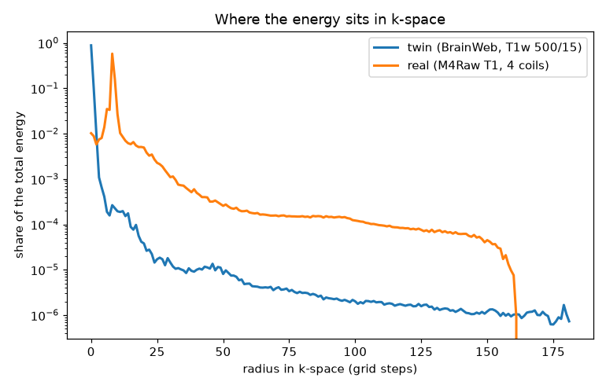

# Validation

Generated by `scripts/validate.py`. 17 / 17 checks pass; ℹ️ rows are measurements without a threshold.

| Check | Expected | Measured | |
|---|---|---|---|
| Round trip image → k → image (brain 256²) | ≈ 1e-15 | 2.8e-16 | ✅ |
| FFT = explicit signal sum (32²) | ≈ 1e-14 | 9.3e-15 | ✅ |
| Hermitian symmetry, twin (magnitude image) | ≈ 1e-16 | 2.1e-16 | ✅ |
| 8-cycle grating → dots at kx | −8, 0, +8 | -8, 0, +8 | ✅ |
| Low-pass + high-pass = image | ≈ 1e-15 | 2.8e-16 | ✅ |
| T1w (500/15): WM > GM > CSF | decreasing | 0.319 > 0.289 > 0.142 | ✅ |
| T2w (2000/120): CSF > GM > WM | decreasing | 0.267 > 0.214 > 0.194 | ✅ |
| Ernst angle WM, TR 30 ms | numerical max 15.74° | 15.74° | ✅ |
| T2 map, noiseless (CSF/GM/WM) | rel. error ≤ 1e-9 | 4.3e-16 | ✅ |
| TSE with ETL 1 = spin echo | ≈ 0 | 0.0e+00 | ✅ |
| Scan time SE 500 ms × 256 | 128 s | 128 s | ✅ |
| TSE ETL 16 vs SE (TE 100), 16× faster | same contrast, some lost detail (no threshold set) | SSIM 0.805, NRMSE 0.101 | ℹ️ |
| Noise in air: mean / σ | √(π/2) = 1.253 | 1.251 | ✅ |
| Noise in air: std / σ | 0.655 | 0.654 | ✅ |
| Aliasing R = 2 = ½(I + I shifted N/2) | ≈ 0 | 2.2e-16 | ✅ |
| M4Raw T1: our reconstruction vs the dataset’s | NRMSE ≈ 0 | 9.3e-08 | ✅ |
| M4Raw T2: our reconstruction vs the dataset’s | NRMSE ≈ 0 | 8.9e-08 | ✅ |
| Hermitian symmetry, real k-space (M4Raw T2, coil 1) | broken (real phase) | 1.42 | ✅ |
| Real k-space: radius of the energy peak (M4Raw T1) | twin: 0. Real: peak not at k = 0, probably an off-centre echo (a phase ramp); not investigated | 8 steps | ℹ️ |
| Real k-space: energy share per ring at radius 100–150 | twin: 1.6e-06; the real floor is probably mostly noise | 7.7e-05 | ℹ️ |

## Known limitations

- **Simulated contrast**: the anatomy is real (BrainWeb), but each tissue is a flat value from the signal
  equation: no partial volume, no texture, no noise unless added.
- **Magnitude only**: the twin's images have no phase, so its k-space is perfectly Hermitian; real k-space is not.
- **Parameter values**: T1 of WM, GM, CSF, fat and T2 of WM, GM, CSF are course values at 1.5 T. PD, T2*
  and all other tissues are placeholders. WM and GM share PD = 0.8 on purpose.
- **Idealised sequences**: TE ≪ TR, perfect RF pulses, no stimulated echoes in TSE, perfect spoiling in GRE.
- **Real data**: M4Raw is 0.3 T, not 1.5 T, and a different subject: it validates reconstruction, not contrast values.
- **NRMSE** under-rates blur; SSIM is reported where detail matters.
